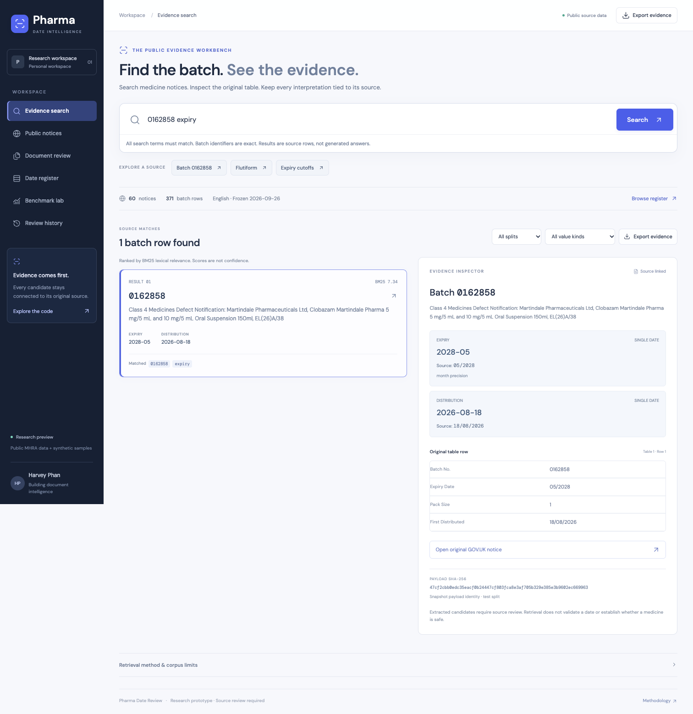
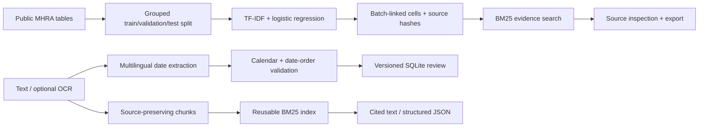

# Pharma Date Review

[](https://github.com/gitLamHoang/pharma-ocr-date-rag/actions/workflows/ci.yml)
[](https://github.com/gitLamHoang/pharma-ocr-date-rag/actions/workflows/pages.yml)
[](pyproject.toml)
[](LICENSE)

**Find a batch. Inspect its dates. Verify the source.**

A document intelligence workbench for pharmaceutical date evidence. Search a frozen corpus of **60 public MHRA notices**, inspect batch-linked source rows, and export citations. Review ambiguous dates in a separate multilingual workspace with an append-only decision history.

[**Open the workspace**](https://gitlamhoang.github.io/pharma-ocr-date-rag/) · [Architecture](docs/architecture.md) · [Retrieval design](docs/retrieval.md) · [Dataset and model card](docs/public-data.md)



## Explore the evidence

The browser requires no account or API key. Search a medicine or exact batch, open its evidence, then export the search results. Each result retains the source notice, table position and content hash. Expiry cutoffs, distribution statements and ambiguous dates remain distinct.

| Workspace | What you can inspect |
| --- | --- |
| Evidence search | Ranked batch rows, matched terms, original cells and query-linked JSON exports |
| Public notices | 742 candidate cells with date-type, value-kind and split filters |
| Document review | Eight synthetic documents, source highlights, explicit date interpretations and reasoned decisions |
| Date register and history | Review status, CSV/JSON exports and previous browser decisions |
| Benchmark lab | Individual synthetic extraction cases and their expected results |

The public corpus is an English historical snapshot, not a live recall feed. The five-language review examples are synthetic. The hosted app runs locally in the browser; it does not upload files or run OCR. Browser reviews stay in local storage.

## Run it

**Browser workspace** · Node 24.12+

```bash
git clone https://github.com/gitLamHoang/pharma-ocr-date-rag.git
cd pharma-ocr-date-rag/web
npm ci
npm run dev
```

**Python extraction and retrieval** · Python 3.9+ · no runtime dependencies

```bash
# From the repository root
python3 -m venv .venv
source .venv/bin/activate
pip install -e .

pharma-date-rag extract data/multilingual_docs --format json
pharma-date-rag ask data/multilingual_docs --question "expiry" --format json --top-k 3
```

For an interactive local text sandbox, install `pip install -e ".[demo]"`, then run `streamlit run demo_app.py`. Optional Tesseract experiments require the native engine and language packs. [OCR setup and measured limits](docs/image-ocr.md).

## Engineering



**Retrieval.** The Python index caches term statistics and extracted dates, uses BM25 ranking, and returns exact source spans. Structured results include chunk hashes, matched terms and unresolved date alternatives. The browser uses a separate row index over public table evidence. Scores express lexical relevance, not confidence in a date. [Algorithm, contracts and evaluation](docs/retrieval.md).

**Models.** A character 3–5-gram TF-IDF vectorizer and class-balanced logistic regression classify table-column roles. Training uses 36 notices, with 12 validation and 12 test notices. Grouping keeps identical payloads together. Features are fitted on training data only. The report compares learned, keyword and majority baselines and exposes repeated headings. [Protocol and model card](docs/public-data.md).

**Uncertainty.** The parser supports English, French, German, Spanish and Vietnamese date vocabulary. It preserves numeric ambiguity, month precision, unchanged source text and review reasons. A cutoff never becomes an exact date. For example:

```python
from pharma_ocr_date_rag.dates import extract_dates

hit = extract_dates("Date de péremption: 09/10/2026", language="fr")[0]
assert hit.normalized is None
assert hit.candidates == ("2026-09-10", "2026-10-09")
```

**Review state.** SQLite stores versioned documents and append-only decisions. Atomic lifecycle operations support reopening, retirement and restoration. Migrations retain historical decisions. Browser reviews are a separate local store, without authentication or synchronization. [Lifecycle semantics](docs/review-lifecycle.md).

## Measured results

| Experiment | Result | What it establishes |
| --- | --- | --- |
| Public column classification | Model 80/80; keyword rules 80/80; majority 23/80 | No measured advantage over rules; 76/80 test headings occur in training |
| Original public PDF experiment | Tesseract and native text each recover 11/11 supported date interpretations | Three PDFs / six pages; not whole-document OCR accuracy |
| Synthetic multilingual parser | 42/42 exact cases in both recognition modes | Authored regression fixtures, not unseen vendor performance |
| Synthetic image OCR | 16/16 fields on clean pages; 8/16 after degradation, with four extra predictions | Three pages in EN/FR/VI; valid-looking incorrect dates still occur |

The public register contains 539 single-date cells, 123 ambiguous cells, 3 cutoffs, 39 distribution statements and 38 unsupported values. These are extraction outputs that require review, not independent ground-truth annotations.

The retrieval evaluation compares BM25 with the previous cosine baseline on explicit authored relevance judgments. It reports ranking and abstention separately. See the [retrieval report](reports/retrieval_quality.json) and [evaluation scope](docs/retrieval.md); these cases do not establish production search accuracy.

## Reproduce and test

```bash
uv sync --frozen --python 3.12 --extra dev --extra demo --extra research
uv run pytest -q
uv run ruff check .
uv run ruff format --check .
uv run python scripts/benchmark_retrieval_quality.py --check
uv run python scripts/train_mhra.py --check
uv run python scripts/export_evidence.py --check
uv run python scripts/export_web.py --check

cd web
npm ci
npm test
npm run build
npx playwright install chromium
npm run test:browser
```

CI checks Python compatibility, frozen evidence, classifier retraining, the production browser build, desktop/mobile workflows and an isolated wheel installation. Browser checks exercise search, exports, date resolution and persisted decisions. [Full contributor checks](CONTRIBUTING.md).

## Project map

| Path | Responsibility |
| --- | --- |
| `src/pharma_ocr_date_rag/` | Extraction, retrieval, public data, SQL review and CLI |
| `web/src/` | Typed evidence model, local search and review interface |
| `data/` | Frozen public corpus, labels, protocols and synthetic fixtures |
| `reports/` | Reproducible measurements and recorded OCR transcripts |
| `scripts/` | Collection, training, evaluation, snapshots and wheel verification |
| `tests/` | Domain logic, data provenance, migrations and integration checks |

[CLI workflows](docs/cli.md) · [Date conventions](docs/date-conventions.md) · [Failure modes](docs/failure_modes.md) · [Product decisions](docs/design.md) · [Contributing](CONTRIBUTING.md)

## Scope and attribution

This is an independent research prototype with AI-assisted development. It contains public MHRA material and synthetic fixtures, not Pfizer-confidential documents or an employer's implementation. There are no measured production savings or clinical validation results.

Despite the repository name, answers are retrieved evidence, not LLM-generated text. There is no working LlamaIndex index or Mistral/Phi-2 benchmark. The optional PaddleOCR adapter remains unverified. Template-diverse annotations and broader scan coverage remain open research needs.

Code is [MIT licensed](LICENSE). Public-sector source content retains its [Open Government Licence attribution and exclusions](data/public_mhra/LICENSE.md).
