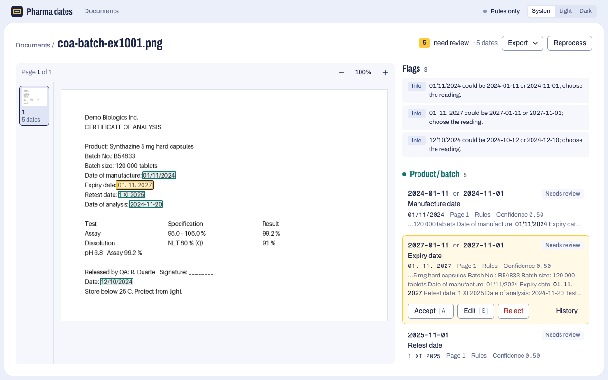

# Pharma Date Extraction

Finds every date in a pharmaceutical document, says what each one means, shows where it is on the page and checks that the dates agree, so a reviewer on a pharmaceutical quality team can confirm them instead of hunting for them.



## What you get

Upload a PDF (native text or scanned) or a PNG, JPG or TIFF image, up to 50 MB and 100 pages. Each date comes back with its type, original text, ISO value (or both readings when `09/10/2026` is ambiguous), page, box, evidence, source and confidence. The types:

| Family | Types |
|---|---|
| Product / batch | manufacture, expiry, retest, packaging, release (incl. QP certification), sampling, test, analysis report |
| Document control | effective, issue, version, approval, review, next review, superseded |
| Signature | signature (with signer and meaning: author, reviewer, approver, witness, QP) |
| Legal / regulatory | certificate issue, certificate valid until, notarization, apostille, legalization, translation certification, authorization |
| Audit / inspection | inspection, audit, next audit, CAPA due |
| Logistics | shipping, receipt |
| Other | other (with a free-text qualifier), unknown |

Consistency flags catch expiry before manufacture, a legalization chain out of order, an expired certificate, a signature in the future and an unresolved ambiguous date, among others. The reviewer accepts, corrects or rejects each date with a name and a reason. Every decision is kept in an append-only history, and the result exports as CSV or JSON.

## Quick start

**Docker** (Tesseract included):

```sh
cp .env.example .env    # optional: add a key for AI labels; without it the app runs offline
make up                 # mkdir -p data, then docker compose up --build
```

Open http://localhost:8000. Data (database, uploads, page images) is kept in `./data`.

The app has no login, so Compose publishes it on the loopback interface only (`127.0.0.1:8000`). To use it from other machines, put a reverse proxy with authentication in front of it; do not publish the port on every interface.

If you run `docker compose up --build` yourself, create `./data` first (`mkdir -p data`); otherwise Docker creates it as root on Linux and the app, which runs as uid 1000, cannot write to it.

**Local development** needs Python 3.12 with [uv](https://docs.astral.sh/uv/), Node 22 and Tesseract (`brew install tesseract` or `apt install tesseract-ocr`):

```sh
make dev     # API with reload on :8000, Vite on http://localhost:5173
make test    # backend pytest and frontend Vitest
make eval    # fetch the public evaluation set and score it (AI=on to include Claude)
```

The browser smoke test runs with `cd frontend && npx playwright install chromium && npm run build && npx playwright test` (the install downloads Playwright's Chromium once, into its user cache); it starts its own offline server.

## Configuration

Settings are environment variables, read from `.env` at the repo root (git-ignored; `.env.example` lists them with placeholders; an empty value means the default).

| Variable | Default | Meaning |
|---|---|---|
| `CLAUDE_PROVIDER` | `anthropic` | `anthropic`, `bedrock` or `vertex` |
| `ANTHROPIC_API_KEY` or `ANTHROPIC_AUTH_TOKEN` | empty | Credentials for the Anthropic API |
| `AWS_REGION` | empty | Amazon Bedrock region; AWS credentials come from the usual AWS environment variables or profile |
| `VERTEX_PROJECT_ID`, `VERTEX_REGION` | empty, `global` | Google Vertex AI project and region; credentials from Google application default credentials |
| `AI_ENABLED` | `true` | `false` forces offline mode |
| `CLAUDE_MODEL` | `claude-opus-5-5` | Model id |
| `DATA_DIR` | `data` | Where the database, uploads and page images live |

**Offline mode.** With `AI_ENABLED=false`, or with no credentials for the chosen provider, the app uses the date rules and Tesseract only. Dates are still found and located; types come from English keyword rules, and most fall back to `unknown`. The UI shows "Rules only" and a banner on the Documents screen.

## How it works

1. **Ingest.** Check type and size, hash the file (an identical re-upload opens the stored result), render each page at 200 DPI.
2. **Text and layout.** Words and boxes from the PDF text layer, or Tesseract on scans; with AI on, Claude also transcribes scanned pages.
3. **Candidates.** Date rules find, normalize and locate every date string, keep both readings of an ambiguous date and keep month-only dates at month precision.
4. **Classify.** One Claude call per page labels each candidate from the taxonomy and may report dates the rules missed. Those are marked AI-only and kept only if the rules parse them and they appear on the page.
5. **Validate.** Deterministic rules over the document's dates raise error, warning and info flags.
6. **Store and review.** SQLite holds documents, runs, dates, flags and the append-only review history. Reprocessing creates a new run and carries decisions over where the date is unchanged.

## Data handling

- **Sent to the AI provider** (only when AI is on): each page's image, its extracted text and the list of date candidates. Nothing else leaves the machine.
- **Kept local:** uploaded files, page images, the database and logs, all under `DATA_DIR`. Logs never print keys or document text.
- **No secrets in the repo.** Keys live only in the git-ignored `.env`; the Docker image is built without it and reads it at run time. A secret scan runs in pre-commit (detect-secrets) and in CI (gitleaks). The evaluation set uses public documents only, fetched by script.

## Accuracy and limits

Measured offline (`--ai off`) on 15 public documents with 123 hand-labelled dates (FDA inspection reports and approval letters, NIST certificates, MHRA notices, the HCCH model apostille):

- **Detection:** precision 1.00, recall 0.85 (105 of 123 dates found, type ignored).
- **Hallucinations: 0.** No stored date is missing from its page. **Silent resolutions: 0.** No ambiguous date was given one reading without evidence.
- On 300 synthetic degraded scans (blur, low DPI, rotation, JPEG, noise, stamps) offline detection is precision 0.99, recall 0.89. Details are in [docs/accuracy.md](docs/accuracy.md).
- Offline type labels are weak (micro F1 0.19 on the public set); AI labelling is implemented but has not been scored here. Run `make eval AI=on` with credentials to measure it.

Misses include date ranges written as one string, two-digit years, badly degraded scans and dates printed only inside photographs. The app supports English documents. **Every date needs human review:** the app finds and suggests, and a reviewer decides.

## License

MIT. See [LICENSE](LICENSE).
